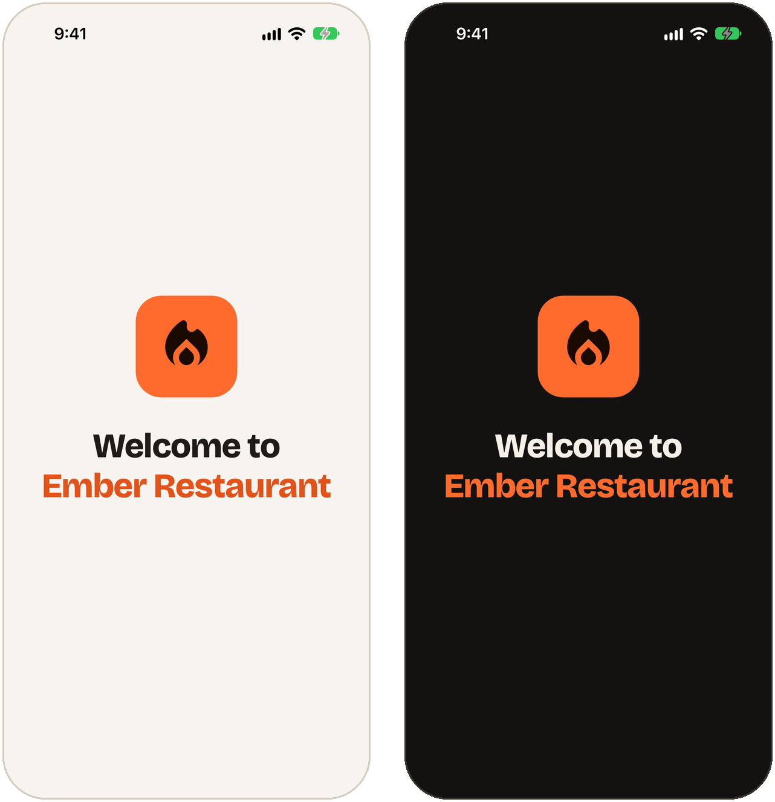

# Ember App Starter

<p align="center">
  
</p>

The starting point for **Ember Kitchen from Scratch**, the ReactBD course where you build a full food-ordering app with
React Native and Expo: a customer app, a restaurant console and a staff workflow, backed by Firebase, Stripe and a
Fastify API.

This repo is the project exactly as it stands after the course's first three chapters. It has one screen that says
**Welcome to Ember Restaurant**, every font and image the app will use, and the ground rules the rest of the course
builds on: strict TypeScript, ESLint and editor settings. There are no features yet. Building them is what the course
is for.

## Where this fits in the course

| Chapter | Starts at | What happens |
|---|---|---|
| 2. An empty folder | 13:22 | builds this repo: the workspaces, the Expo app, the asset pack, the first screen |
| 3. The ground rules | 21:59 | strict types, the `@/` alias, linting, editor settings |
| **4. The design system** | **26:58** | **start here** if you cloned this starter |

Watching from the beginning? Chapters 2 and 3 type all of this out step by step. You can follow along from an empty
folder, or keep this repo open to compare.

## What you need

- **A Mac with Xcode** for the iPhone simulator, and/or **Android Studio** for the Android emulator. On Windows or
  Linux you can follow the course on Android.
- **Node 22 or newer.** Check with `node -v`.
- **Git**
- **VS Code** with the **Expo Tools** extension. VS Code suggests it when you open the folder.
- **Expo Go for SDK 57**, on the iPhone simulator or the Android emulator. The App Store's Expo Go can't open
  this project; [Troubleshooting](#troubleshooting) has what works on a real phone.

## Quick start

```bash
git clone https://github.com/noorjsdivs/ember-app-starter.git
cd ember-app-starter
npm install
npm run dev:mobile
```

One `npm install` at the root installs all three workspaces. When Metro is running, press:

- <kbd>i</kbd> to open the app on the iPhone simulator
- <kbd>a</kbd> to open it on the Android emulator (start the emulator from Android Studio first)

You should see the screen above. It follows your phone's light or dark setting.

## Scripts

Run these from the repo root:

| Command | What it does |
|---|---|
| `npm run dev:mobile` | starts the Expo dev server for the app |
| `npm run typecheck` | type-checks every workspace with `tsc --noEmit` |
| `npm run lint` | runs Expo's ESLint rules in every workspace that has them |

Both checks pass on a fresh clone. Keep it that way as you build: run them before every commit.

## What's inside

```text
ember-app-starter/
├── package.json            npm workspaces: shared, server, mobile
├── .gitignore              also ignores env files, signing keys and Firebase key files
├── .vscode/                fix and organise imports on save; recommends Expo Tools
├── docs/welcome.png        the screenshot above
├── mobile/                 the Expo app: SDK 57, Expo Router, React Compiler on
│   ├── app.json            name, icons, splash screen, bundle identifier
│   ├── tsconfig.json       strict mode, and the @/ alias for src/
│   ├── eslint.config.js    Expo's lint rules
│   ├── assets/
│   │   ├── fonts/          the type and icon fonts (below)
│   │   └── images/         the app icon, Android icon layers, splash image, favicon
│   └── src/app/            every file here is a screen (Expo Router)
│       ├── _layout.tsx     loads the title font and keeps the splash screen up until it's ready
│       └── index.tsx       the welcome screen
├── shared/                 the types and rules the app and the server will share (empty for now)
│   └── src/index.ts
└── server/                 the Ember API: only a package.json until chapter 12
```

### The stack

| | Version |
|---|---|
| Expo SDK | 57 |
| React Native | 0.86 (New Architecture) |
| React | 19.2, with the React Compiler |
| Expo Router | 57 |
| TypeScript | 6.0, strict |

Stay on SDK 57 while you follow the course. The code in the video is written for it, so don't upgrade Expo partway
through.

## The asset pack

The video description links to an asset pack. It's already unpacked here, in `mobile/assets`.

### Fonts — `mobile/assets/fonts`

| File | What it is |
|---|---|
| `Bricolage-600-16.ttf` … `Bricolage-800-40.ttf` (9 files) | **Bricolage Grotesque**, the display typeface, in weights 600, 700 and 800, each at three optical sizes. The `-16` cut is drawn for small text (up to 18 px), `-24` for headings (up to 26 px) and `-40` for big titles. React Native can't drive a variable font's optical-size axis, so each size is its own file. |
| `MaterialSymbolsOutline.ttf` | **Material Symbols**, outlined style, cut down to the icons Ember uses |
| `MaterialSymbolsFill.ttf` | the same icons, filled |
| `glyphmap.json` | each icon's name and its code point in both icon fonts (176 icons) |

The welcome screen already uses one of them: the title is set in `Bricolage-800-40`. Chapter 4 loads the rest and
builds the type scale on them.

### Images — `mobile/assets/images`

| File | Size | Used for |
|---|---|---|
| `icon.png` | 1024 × 1024 | the app icon (and the welcome screen's logo) |
| `android-icon-foreground.png` | 1024 × 1024 | Android adaptive icon, the flame layer |
| `android-icon-background.png` | 1024 × 1024 | Android adaptive icon, the background layer |
| `android-icon-monochrome.png` | 1024 × 1024 | Android themed (monochrome) icon |
| `splash-icon.png` | 1024 × 1024 | the splash screen, on the dark `#120F0C` background |
| `favicon.png` | 196 × 196 | the browser tab icon on web |

`mobile/app.json` already points at all of them.

### Licences

- **Bricolage Grotesque**: © The Bricolage Grotesque Project Authors, under the
  [SIL Open Font License 1.1](https://openfontlicense.org/).
- **Material Symbols**: © Google, under the [Apache License 2.0](https://www.apache.org/licenses/LICENSE-2.0).

## Make it yours

- **Change the bundle identifier before you build.** `mobile/app.json` uses `com.reactbd.ember` for both iOS
  (`ios.bundleIdentifier`) and Android (`android.package`). App Store Connect and Google Play need one that's unique
  to you, such as `com.yourname.ember`. Expo Go doesn't care, so you can leave it while you follow along.
- **Never edit `mobile/ios` or `mobile/android` by hand.** They don't exist yet. Expo generates them from `app.json`
  when you make a development build, and `.gitignore` keeps them out of Git. Native settings go in `app.json`.
- **Keep secrets out of Git.** Later chapters add `.env` files and Firebase key files. `.gitignore` already ignores
  them. Check `git status` before you push anyway.

## Troubleshooting

**“Project is incompatible with this version of Expo Go”**
Each Expo Go build runs exactly one SDK, and this project uses SDK 57. Expo's own
[troubleshooting page](https://docs.expo.dev/troubleshooting/expo-go-version-mismatch/) says the App Store's Expo Go
stops at SDK 54, so the iPhone app from the store can't open this project. What works:

- **iPhone simulator or Android emulator** (easiest): Expo CLI installs Expo Go when you press <kbd>i</kbd> or
  <kbd>a</kbd>. If it installed the wrong one, pick SDK 57 at [expo.dev/go](https://expo.dev/go) and install that
  build.
- **Android phone:** install the SDK 57 build from [expo.dev/go](https://expo.dev/go). Google Play's version can be
  ahead of or behind the project.
- **iPhone:** build your own Expo Go with `eas go` and install it through TestFlight (this needs an Apple Developer
  Program membership), or make a development build with `npx expo run:ios`.

**The screen is blank, or you see an old version of it**
Restart Metro with a clean cache:

```bash
cd mobile
npx expo start --clear
```

**`npm install` fails or the app can't find a package**
Check that you're on Node 22 or newer (`node -v`) and that you ran `npm install` from the repo root, not from inside
`mobile`.

**Port 8081 is already in use**
Another Metro server is still running. Stop it, or press <kbd>Y</kbd> when Expo offers to use another port.

## ReactBD

- YouTube: [@reactjsbd](https://www.youtube.com/@reactjsbd)
- Website: [reactbd.com](https://reactbd.com)

Stuck at a checkpoint in the course? Leave a comment on the video with the chapter and what you see.
